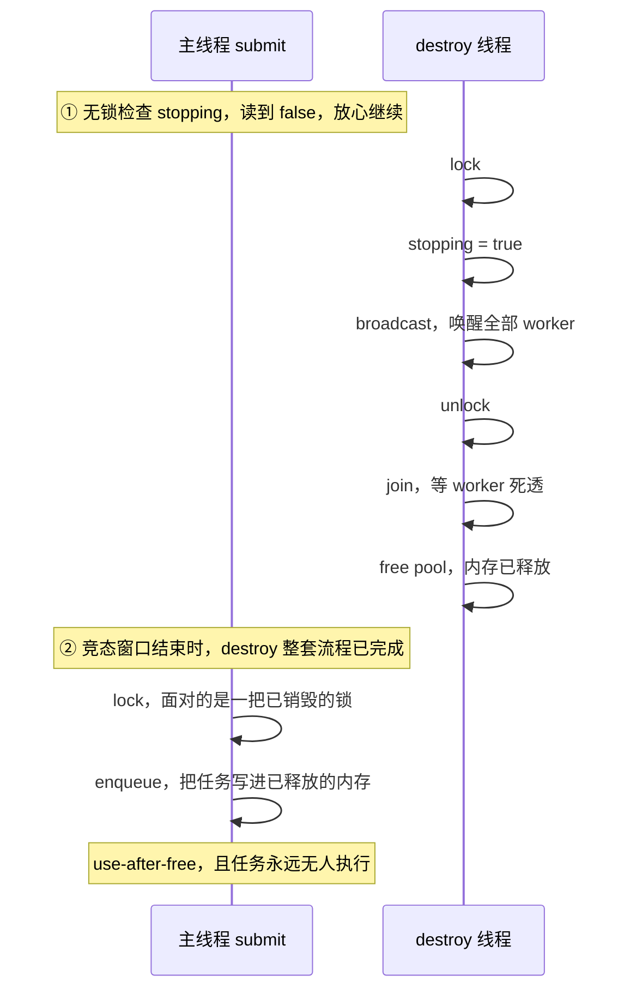
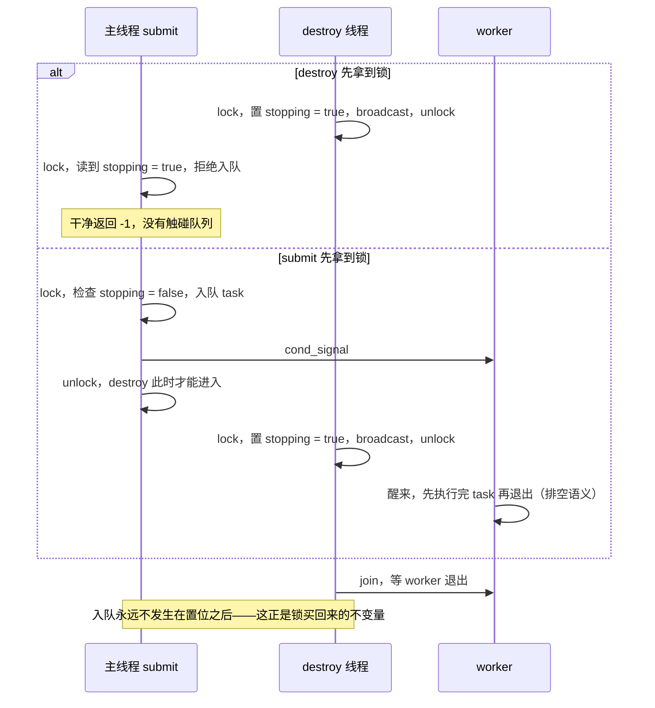
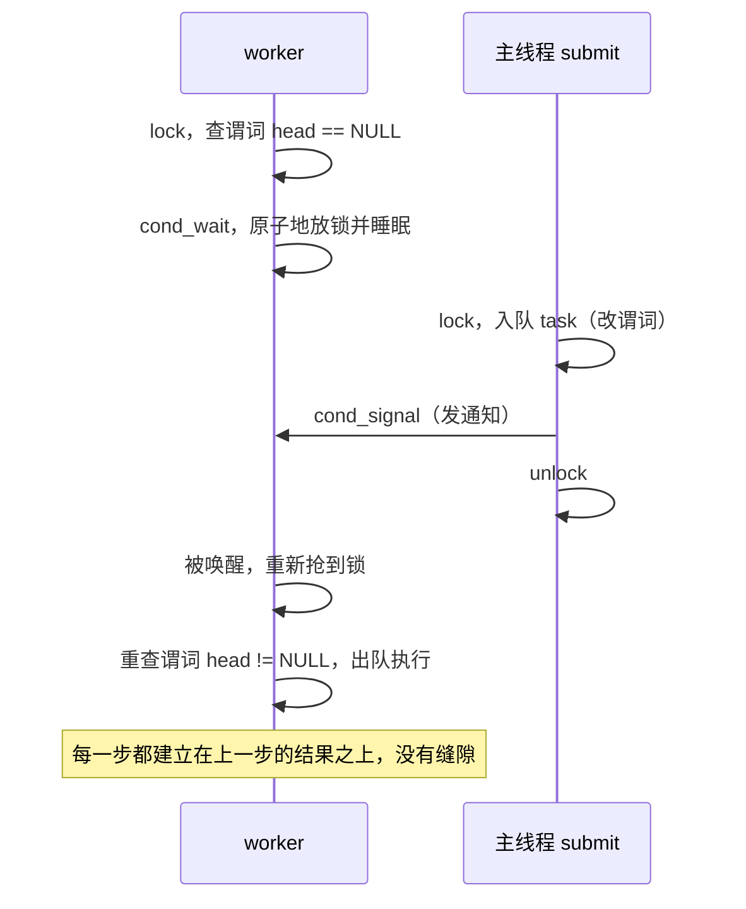
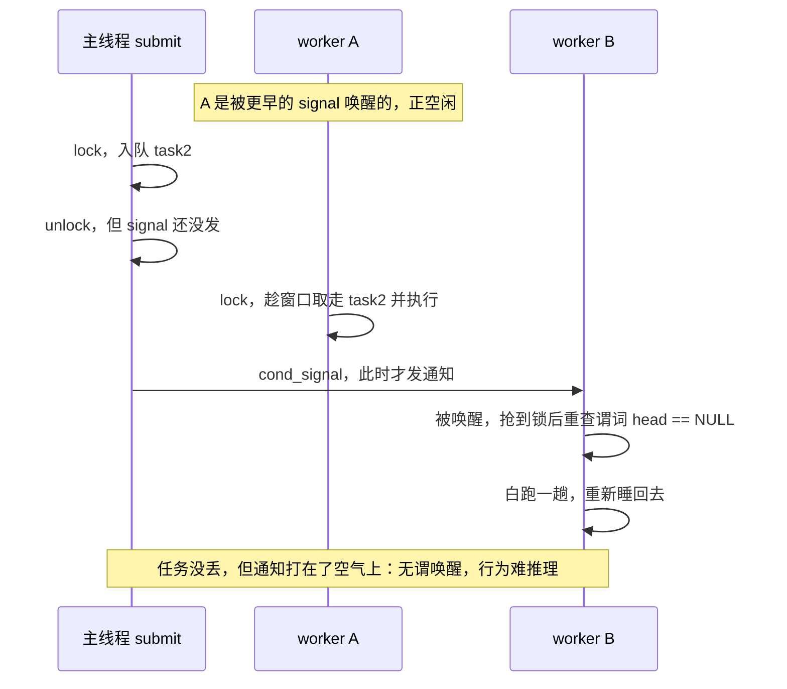
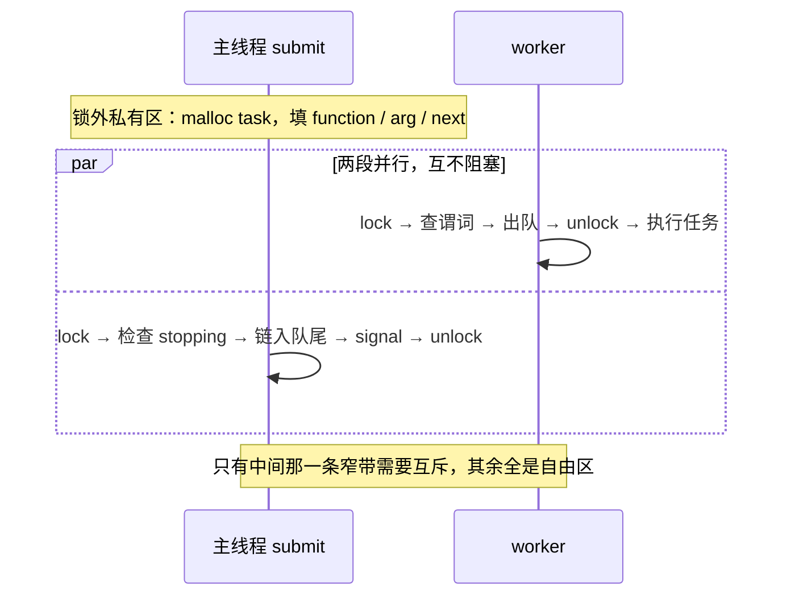

线程池是面试手撕的常客。它的代码量不大——一个结构体、四个函数——但每个函数都踩在并发的经典考点上：锁画在哪里、条件变量怎么配对、关闭流程怎么不漏资源。

这篇文章按我自己的学习顺序写：先给出我最初的理解，再逐条对照实现验证，然后深挖三个让我纠结过的锁边界设计，最后回答一个困扰我很久的问题——worker 线程到底由谁管理。

## 一、整体结构：一个结构体 + 四个函数

```c
typedef struct threadpool {
    pthread_t *threads;       // 工作线程数组
    size_t thread_count;

    task_t *head;             // 任务队列（链表）出队端
    task_t *tail;             // 入队端

    pthread_mutex_t mutex;    // 保护队列和状态
    pthread_cond_t condition; // 通知 worker

    bool stopping;            // 是否正在关闭
} threadpool_t;

typedef struct task {
    task_fn function;
    void *arg;
    struct task *next;        // 链成队列
} task_t;
```

四个函数的职责：

| 函数 | 线程 | 职责 |
|------|------|------|
| `threadpool_create` | 主线程 | 初始化、创建工作线程、失败回滚 |
| `threadpool_submit` | 主线程 | 加锁入队、唤醒一个 worker |
| `worker` | 工作线程 | 锁内出队、锁外执行任务 |
| `threadpool_destroy` | 主线程 | 置停止位、通知、join、释放 |

所有共享数据只有两块：**任务队列**和 **stopping 标志**。锁的全部意义就是保护这两块。

## 二、我的理解，逐条对照实现验证

### 1. 入队和出队存在多线程读写，需要锁

对。`submit` 在主线程入队，`worker` 在工作线程出队，两边竞争同一把 `pool->mutex`。这是整个设计里最没有悬念的一条。

### 2. worker：状态检查和出队在锁内，执行任务在锁外

对，而且这是 worker 段的精髓：

```c
pthread_mutex_lock(&pool->mutex);

while (pool->head == NULL && !pool->stopping)
    pthread_cond_wait(&pool->condition, &pool->mutex);

if (pool->head == NULL && pool->stopping) {   // 队列空 + 正在关闭 → 退出
    pthread_mutex_unlock(&pool->mutex);
    return NULL;
}

task_t *task = pool->head;    // 出队
pool->head = task->next;
if (pool->head == NULL) pool->tail = NULL;

pthread_mutex_unlock(&pool->mutex);

task->function(task->arg);    // ← 执行任务时手里没有锁
free(task);
```

`head`/`stopping` 的读取、指针的改写都在锁内；任务执行挪到锁外。原因很直接：**任务可能很耗时，拿着锁执行会把其他三个 worker 和主线程的 submit 全堵住**。

### 3. create：初始化 → 创建 → 检查 → 失败回滚

顺序正确：先 `pthread_mutex_init` / `pthread_cond_init`，再循环 `pthread_create`，然后检查是否全部创建成功：

```c
if (created != thread_count) {
    pthread_mutex_lock(&pool->mutex);
    pool->stopping = true;
    pthread_cond_broadcast(&pool->condition);
    pthread_mutex_unlock(&pool->mutex);

    for (size_t i = 0; i < created; i++)
        pthread_join(pool->threads[i], NULL);   // 先 join

    pthread_cond_destroy(&pool->condition);      // 再销毁锁/条件变量
    pthread_mutex_destroy(&pool->mutex);
    free(pool->threads);
    free(pool);
    return NULL;
}
```

这里有个容易写错的细节：**必须先 join、再 destroy mutex/cond**。线程还活着就销毁它正在用的锁，是未定义行为。

### 4. destroy：置位 → 通知 → 回收 → 清理

```c
pthread_mutex_lock(&pool->mutex);
pool->stopping = true;
pthread_cond_broadcast(&pool->condition);   // 必须 broadcast，signal 只唤醒一个
pthread_mutex_unlock(&pool->mutex);

for (size_t i = 0; i < pool->thread_count; i++)
    pthread_join(pool->threads[i], NULL);   // 等所有 worker 退出

while (pool->head) { ... free(tmp); }       // 清残留任务
pthread_cond_destroy / pthread_mutex_destroy / free
```

对照实现后我补充了两个自己没想透的语义：

- **"排空队列后再退"**：worker 只在 `head == NULL && stopping` 时才退出。所以 destroy 绝不能先清队列——那会把还没执行的任务从 worker 手里抢走。顺序只能是"通知 → join 等它们干完活 → 再兜底清残留"。
- **必须用 `broadcast` 而不是 `signal`**：`signal` 只唤醒一个，其余三个 worker 继续睡，`join` 就永远等不到了——典型的"关闭死锁"。

### 5. submit：锁内入队，首次入队建立头尾

对。且不止入队，**stopping 检查和 `cond_signal` 也在锁内**；而 `malloc` 建节点反而在锁外。这三个边界为什么这么画，是下一节的主角。

## 三、一个疑惑：worker 到底由谁管理？

我最初的问题是：*"worker 线程是 pool 线程创建的，那之后 worker 的管理策略也是 pool 来管理吗？"*

这个问题的前提就有个误解：**不存在"pool 线程"**。`threadpool_t` 只是一块内存，不是线程。真正的创建者是主线程——`main` 调 `threadpool_create`，主线程执行 `pthread_create` 造出 4 个 worker，并把 `pool` 指针传进去。

所以真正的问题是：**worker 创建出来之后，谁在管理它？**

答案是：**没有任何线程在"指挥"worker。管理不是一条控制链，而是一份共享数据 + 一套双方遵守的协议。**

1. **`pthread_create` 只负责"生"，不负责"管"。** worker 出生后由操作系统调度，和主线程是平等的对等线程，没有父子从属关系。

2. **"管理策略"全部编码在 `pool` 这块共享内存里：**
   - 加任务：主线程 `submit` 入队 + `signal` → worker 醒来取活；
   - 叫停：主线程 `destroy` 置 `stopping` + `broadcast` → worker 自己检查到条件满足后**主动退出**；
   - 回收：主线程 `join` 等它们死透。

3. 也就是说：**主线程只负责改共享状态、发唤醒信号；worker 读状态、自己决定干什么。** 线程之间没有直接的指挥渠道，全靠锁保护下的共享状态通信——这正是互斥锁 + 条件变量存在的意义。

用 gdb 跑起来 `info threads` 能直观验证：1 个 `main` + 4 个 `worker`，没有任何叫 "pool" 的线程。主线程是协议的发起方，worker 是响应方，**管理策略属于"数据 + 协议"，不属于任何特定线程**。

## 四、深挖：锁的边界为什么画在这里

`submit` 里有三个位置选择——`stopping` 检查放哪、`signal` 发哪、`malloc` 做哪——分别对应并发编程的三个经典问题：**检查-行动竞态、通知协议的原子性、临界区粒度**。这一节逐个展开，每个都配一张并发时序图。

### 4.1 为什么 stopping 检查必须在锁内——防"检查-行动"竞态

**正确代码的形状**（`threadpool.c:26-33`）：先拿锁 → 检查 `stopping` → 立即入队 → 解锁。"检查"和"行动"被同一把锁包成一个整体，中间没有缝隙。

假如把检查挪到锁外，代码会退化成这样：

```c
if (pool->stopping) return -1;   // ① 无锁检查，读到 false
                                  // ② ← 竞态窗口
pthread_mutex_lock(&pool->mutex);
enqueue(task);
```

在 ① 和真正拿到锁之间，destroy 可以插进来做完整套关闭流程：



**图 1：无锁检查让 destroy 趁隙完成整套关闭，submit 随后对"尸体"操作**

后果二连：

1. **任务塞进去了，但 4 个 worker 已全部退出**——任务永远无人执行，task 节点内存泄漏；
2. **`pool` 已被 `free`**——往已释放内存里写是 use-after-free，未定义行为：可能当场段错误，也可能"看起来没事"埋雷。

这就是 TOCTOU（Time-of-check to time-of-use）：**检查和使用之间存在时间差，状态趁这段时间变了**。修复原则：

> **"判断状态"和"基于该状态修改共享数据"必须在同一个临界区内完成，中间不允许任何线程插足。**

加上锁之后，destroy 想置位就必须先和 submit 抢同一把锁，所有交错被压缩成两种合法顺序：



**图 2：上锁后只剩两种合法交错，两种都安全**

destroy 先到，submit 被 `stopping` 挡回去；submit 先到，任务会被"排空再退"的 destroy 收尾执行。**入队不可能发生在置位之后**——这就是把检查放进锁内买到的不变量。

严谨补充一个边界：以上讨论的前提是"pool 内存还活着"。如果调用方在 `threadpool_destroy` **完全返回之后**才调用 submit，那相当于对着已释放的内存调用任何函数，锁救不了这种情况——只能靠 API 契约规定"`destroy` 之后不得再 `submit`"。若想支持"关闭进行中仍可安全提交"，需要引用计数一类更重的机制，生产级线程池常见，面试手撕一般不必。

**锁的第二重收益：内存可见性（happens-before）。** destroy 在锁内写的 `stopping = true`，submit 拿到同一把锁后必然读到最新值；不加锁的话，读到的可能是 CPU 缓存里的陈旧值——在现代弱内存模型下这不是理论洁癖。

**worker 端是同一条道理的镜像**：`worker.c:12` 的 `while (head == NULL && !stopping)` 谓词在锁内查，出队也在锁内做。整个线程池里凡读写 `head/tail/stopping` 的代码全被同一把锁罩住——**"查状态 → 改状态"两端都上锁，协议才闭环**。

### 4.2 为什么 cond_signal 在锁内——"发布 + 通知"是一个原子协议

两端的标准配合长这样：

```c
// 信号方 submit（锁内）            // 等待方 worker（锁内）
lock                               lock
enqueue(task)   ← 改谓词           while (head == NULL && !stopping)
signal(cond)    ← 发通知               cond_wait(&cond, &mutex)
unlock                               // 原子动作：解锁 + 睡眠
                                     // 醒来后：先重新拿锁，再重新查谓词
```

关键在 `pthread_cond_wait` 的原子性：**调用瞬间"放锁 + 挂起"一步完成**，谓词检查和睡眠之间不可能被别的线程插队改状态；被唤醒后还必须**重新抢到锁**才能继续往下走。这是"等待方"的原子性。作为对称，"信号方"也应把**改谓词和发通知绑进同一个临界区**，两边对称，链路才无缝：



**图 3：锁内 signal——入队、通知、重查三步环环相扣**

链路读下来：**入队完成 → 通知发出 → worker 醒来重查 → 一定看到新任务**。每一步都由上一步垫底，没有可乘之隙。

那如果先 `unlock` 再 `signal` 呢？入队本身在锁内完成，所以**不会造成永久睡死**（signal 迟早补发），但窗口期会出现两类坏味道：



**图 4：先解锁后通知——任务被抢、通知打空，协议不再成对**

- **通知与谓词脱钩**：通知到达时，谓词可能已被别人改回去了（如图 4），唤醒变成无谓的折腾；更极端的情况，signal 拖到 destroy 的 `broadcast` + `join` 之后才发，所有 worker 已退出，信号彻底打空——任务靠 destroy 的排空语义没丢，但"通知可能在协议结束后才到达"的代码是 bug 温床。
- **调度不可预测**（POSIX 明确强调的点）：锁内 signal 时，被唤醒者醒来抢 mutex，而锁还在 signaler 手里、马上释放，唤醒路径最短；先解锁再 signal，中间可能被别的线程抢走锁搅一轮，被唤醒者重查谓词后可能又睡回去，唤醒时机变得飘忽。

严谨细节：POSIX 允许信号方**不持锁**发送 signal——只要谓词改动在锁内，正确性就能保住；但它同时明确，**持锁发送才有可预测的调度行为**。所以"锁内 signal"是"正确性 + 可预测调度 + 推理简单"三者兼得的稳妥惯例，也是工程标准写法。代价？临界区里多了几条指令，几乎为零——这笔账很好算。

### 4.3 为什么 malloc 在锁外——临界区越短越好

`submit` 的完整分区：

```text
malloc(task)        ← 锁外（私有）
填 function/arg/next ← 锁外（私有）
─────────────────
lock
  检查 stopping      ┐
  链入队尾（改指针）  ├ 必须原子的，才进锁
  signal             ┘
unlock
return              ← 锁外
```

时序上，锁外的准备工作和 worker 的正常运转完全并行：



**图 5：malloc 在锁外——worker 出队与 submit 的准备工作并行不悖**

三个理由，一个比一个实际：

**（1）私有数据不需要互斥。** 刚 `malloc` 出来的节点，全世界只有当前线程持有它的指针——它还没被链入队列，别的线程根本看不见，随便怎么分配、初始化都无妨。直到 `tail->next = task` 这一瞬，节点才**进入共享领域**。判断标准一句话：*这段代码读写别的线程也能看到的数据吗？* 不是 → 自由区；是 → 临界区。

**（2）性能：malloc 的耗时不可控。** glibc 的 `malloc` 可能竞争堆 arena 锁、走 `brk`/`mmap` 系统调用、触发缺页中断——耗时从纳秒到微秒甚至毫秒级都有可能。锁内每多停一微秒，四个 worker 里但凡有谁想碰队列（出队、查谓词、退出检查）就得集体干等。把这段不可控耗时挪出去，临界区里只剩几条指针赋值，微秒级完成——这就是**临界区最小化**准则。

**（3）失败路径干净。** `malloc` 返回 NULL 时直接 `return -1`（`threadpool.c:16-19`），此时没碰锁、没碰 pool 的任何状态，**零回滚**。假如 malloc 在锁内，失败分支就得记得解锁再返回——忘一下就是死锁，而"异常路径上漏解锁"恰恰是真实事故的高发区。

**一个可以留意的小取舍**：现在的顺序是"先 malloc、后锁内查 stopping"，在关闭瞬间提交会白 malloc 一次、锁内查到 `stopping` 再 free 掉（`threadpool.c:30-32`）。用一次多余分配的代价，换掉"持锁调 malloc"（临界区不可控）和"锁内失败要回滚"（易错路径）两个更大的麻烦——划算。它和前两条是同一个思想：**宁可锁外多做点浪费的功，也不让临界区沾上不可控的东西**。

**统一的判断标准：这段代码读写别的线程也能看到的数据吗？** 不是 → 锁外；是 → 进临界区，进去后尽快出来。

## 五、动手调：gdb 钻进线程里看

多线程程序光读代码不够，得打断点亲眼看。编译必须带 `-g`：

```bash
gcc -std=c11 -g -O0 *.c -o threadpool_test
gdb ./threadpool_test
(gdb) break worker.c:36       # 在 worker 执行任务处
(gdb) run
# 某个 worker 命中断点，gdb 停在它身上——此刻你就在"线程里面"
(gdb) info threads            # 列出所有线程，* 标出当前
(gdb) thread 3                # 切换到 3 号线程
(gdb) bt                      # 看这个线程的调用栈
(gdb) print *task             # 查看该线程的局部变量
(gdb) thread apply all bt     # 一次看所有线程各卡在哪
```

一个关键坑：**默认单步（`next`/`step`）时其他线程继续跑**，可能突然被别的线程的断点劫走。调试某个线程前先锁调度器：

```gdb
(gdb) set scheduler-locking step   # 单步时只有当前线程运行
(gdb) next
(gdb) set scheduler-locking off    # 调完关掉
```

实用断点参考：`break main.c:5`（`print_number` 入口）最省事——任务由 worker 执行，断点自然停在某个 worker 里；`break worker.c:13` 观察条件变量等待，但线程睡着时断点不会触发，要用 `info threads` + `thread N` 切过去看它阻塞在哪个栈帧。

VSCode 里等价的操作：F5 启动后，在 **Call Stack 窗口双击另一个线程的栈帧**即可切换进去（等价于 `thread N`），Variables 面板随之变成那个线程的局部变量；也可以在 Debug Console 直接输入 gdb 命令。

## 六、总结

手撕线程池时脑子里应该过的一张清单：

1. **队列的读写全在锁内**，任务的执行在锁外；
2. **"查状态 → 改状态"必须同一临界区**，否则 TOCTOU；
3. **改谓词和 signal 配对**，关闭用 `broadcast` 不用 `signal`；
4. **destroy 语义是"排空再退"**：通知 → join → 清残留 → 释放，顺序不可换；
5. **临界区最短化**：私有工作（malloc、初始化）放锁外；
6. **worker 没有谁在"管"**——管理策略写在共享数据和协议里，主线程发起、worker 响应。

四个函数写完背下来不难，难的是每个 `lock/unlock` 之间为什么恰好放这几行。想清楚"**锁保护的是共享状态的哪一次突变**"，边界自然就画出来了。

## 相关阅读

线程池复用的是同一进程内的线程；进程、线程与协程的资源和调度差异见[进程、线程与协程的区别]()。
